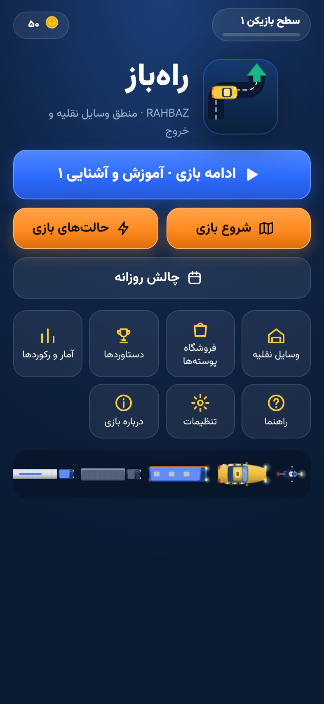
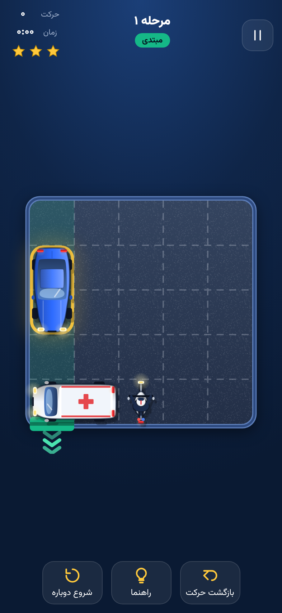
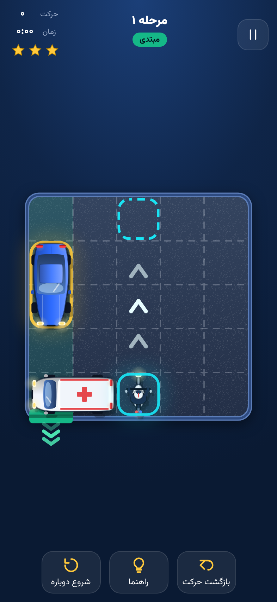
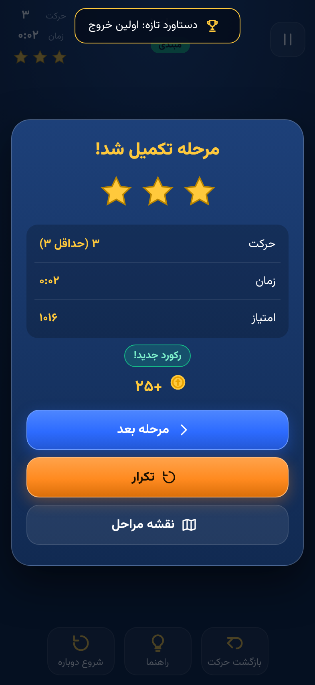

# RAHBAZ – Vehicle Logic & Escape
**Persian name: راه‌باز** · Version 1.0.2 · Creator & developer: **Hamid Yarali (حمید یارعلی)**

RAHBAZ is an independent, **fully offline** vehicle sliding-puzzle game for Android. Every vehicle – from a one-cell motorcycle to buses, trucks, 6-cell trailers and 2×2 excavators – slides only along its own axis. Clear the lane so the glowing gold vehicle can drive out through the green gate.

| Home (Persian, RTL) | Game | Hint | Level complete |
|---|---|---|---|
|  |  |  |  |

> The screenshots are rendered from the real game in Chromium with a phone viewport (they are simulations, not photos of a physical phone).

## Features
- **110 built-in levels** in 11 packs: Learn the Basics, City Parking, Busy Street, Bus Terminal, Truck Park, Heavy Transport Zone, Industrial Zone, Construction Site, Emergency Route, Pro League, Motorcycle Escape. Boards from 5×5 to 8×8 (the generator supports up to 9×9). **Every level is proven solvable** by a BFS solver and carries its exact minimum move count.
- **75 vehicle types** in 8 categories, each with its own size, speed, points value and hand-drawn top-down artwork (not colour swaps): motorcycles (8), cars (16), vans & minibuses (7), buses (7), trucks (11), semi-trailers (9), construction/industrial machinery (12), service vehicles (5).
- **10 modes**: Classic, Motorcycle Escape, Heavy Transport, Public Transport, Emergency Mission, Construction Zone, Endless (3 lives), Daily Challenge (date-seeded), Time Challenge, Minimum Moves.
- **Solver-backed hints**: the highlighted move is always legal and optimal; "Show solution" plays the whole solution. Undo, reset, pause, move limits on selected levels.
- **Progress**: 1–3 stars per level (thresholds relative to the optimal move count), score, coins, XP / player level, 10 achievements, statistics.
- **Shop**: 8 vehicle skins (Classic, Sport, Police, Emergency, Heavy, Construction, Neon, Retro) bought with in-game coins; a Garage that lists every vehicle.
- **Persian (RTL, default) + English (LTR)**, synthesised sound effects and music (WebAudio, no audio files), decorative animations can be switched off.
- **Privacy**: no permissions, no network, no ads, no analytics. Save data stays on the device (versioned, corruption-safe).
- **Tiny**: the signed release APK is about **0.29 MB**.

## How it is built
The game is plain **HTML/CSS/JavaScript (ES modules)** bundled with esbuild (IIFE, ES2018 syntax for Chrome/WebView 61+) and packed into a minimal Android **WebView shell** (one Activity, content served from `assets/www` through `shouldInterceptRequest` on `https://appassets.androidplatform.net/`, so there is no network access at all).

```
src/js/engine.js      grid, collision, ranges        src/js/solver.js     BFS solver (exact minimum moves)
src/js/generator.js   seeded generator + hill climb   src/js/levels-data.js generated levels (scripts/generate-levels.mjs)
src/js/art.js         procedural vehicle artwork      src/js/render.js     canvas board renderer + sprite cache
src/js/game.js        input/animation/undo/hint       src/js/app.js        screens, modes, rewards, navigation
src/boot.js           ES5 boot loader + polyfills + on-screen diagnostics
android/              WebView shell (Java), manifest, resources, Gradle project, prebuilt template APK
scripts/              build-web, build-apk, make-keystore, generate-levels, build-shell, .sh/.bat helpers
tests/                unit tests (node:test), CSS compatibility test, end-to-end tests (Playwright/Chromium)
```
More detail: [docs/ARCHITECTURE.md](docs/ARCHITECTURE.md), [docs/GAME_DESIGN.md](docs/GAME_DESIGN.md), [docs/LEVEL_FORMAT.md](docs/LEVEL_FORMAT.md).

## Build the APK (no Android SDK needed)
Requirements: **Node 18+** and a **JDK 11+** (`java` and `keytool`).
```sh
npm ci
sh scripts/build_android.sh        # Windows: scripts\build_android.bat
# -> release/RAHBAZ-v1.0.2.apk (+ .sha256, CERTIFICATE.txt)
```
The script runs the tests, creates your **own release key** on first use (`Keystore/`, `keystore.properties` – both git-ignored), builds the web bundle, assembles the APK from the prebuilt shell template, signs it (zipalign + v1/v2/v3) and verifies the certificate is **not** the Android debug key. `uber-apk-signer` 1.3.0 is downloaded from GitHub Releases and pinned by SHA-256.

> **Keep `Keystore/` safe.** Every future update must be signed with the same key. Never commit it.
> The key created by the script is generated on the machine that runs it; if you want the key to exist only on your own computer, run `node scripts/make-keystore.mjs` locally before your first release.

Useful commands: `npm test` (unit tests), `npm run test:e2e` (browser tests), `npm run levels` (regenerate levels, slow), `sh scripts/build-shell.sh` (rebuild the shell template – needs `aapt2`, `dx`, `javac`).

### Build AAB / Gradle / GitHub Actions
`android/` is a standard Gradle project (AGP 8.7.3, Gradle 8.9, compileSdk/targetSdk 34, minSdk 24). Create the key, then `cd android && gradle bundleRelease` (no `gradlew` is included – run `gradle wrapper` once if you want one). The workflow `.github/workflows/android-release.yml` builds APK + AAB on tag `v*` and needs these secrets: `ANDROID_KEYSTORE_BASE64`, `ANDROID_KEYSTORE_PASSWORD`, `ANDROID_KEY_ALIAS`, `ANDROID_KEY_PASSWORD` (`base64 -w0 Keystore/rahbaz-release.jks`). **The Gradle project and the workflow were written but could not be executed in the environment where RAHBAZ was authored** – treat them as untested.

## Testing status (honest summary)
- ✔ 12 unit tests pass: engine, solver, all 110 levels re-solved and replayed move by move, generator/daily determinism, hint legality.
- ✔ End-to-end tests in Chromium (phone user-agent, touch, 393×851, 851×393, 640×360, 820×1180): real pointer drags solve a level, save/reload, Back-button protocol, background pause, Persian RTL / English LTR, endless/daily/time modes, no external requests, no CSP violations, boot with modern APIs removed, diagnostic screen on failure.
- ✔ APK: signature verified (v1/v2/v3), RSA 4096 release certificate, no permissions, debuggable=false, zipalign OK.
- ✘ **Not run on a physical phone or Android emulator** (none available while building). Please install the APK on a real device; if anything looks wrong send a screenshot (the app prints a diagnostic page when it cannot start).
- ✘ AAB and the Gradle route were not built here.

## Known limitations / deviations from the original brief
- The brief asked for Kotlin/Compose *and* (in the build template) a WebView shell. I implemented the **WebView shell** – it builds offline, is tiny, and matches the template. It is not a Kotlin app.
- Ads, in-app purchases and the other monetisation ideas are **not implemented** (the game ships with no permissions and no network). Skins are bought with in-game coins only.
- Skins change palette/decorations of the same artwork; they are not separate artwork sets. Vibration is not used (it needs a permission).
- Semi-trailers are single rigid units (as suggested for v1). The hero vehicle is always one cell wide; 2-wide machinery appears as blockers.
- Difficulty: all six tiers exist (5 Beginner / 30 Easy / 42 Medium / 18 Hard / 8 Expert / 7 Master). The upper tiers are mostly in the Pro League pack; harder 7×7/8×8 layouts were limited by solver cost while generating.

## License
MIT © 2026 Hamid Yarali – see [LICENSE](LICENSE). Font: Vazirmatn (SIL OFL 1.1).
