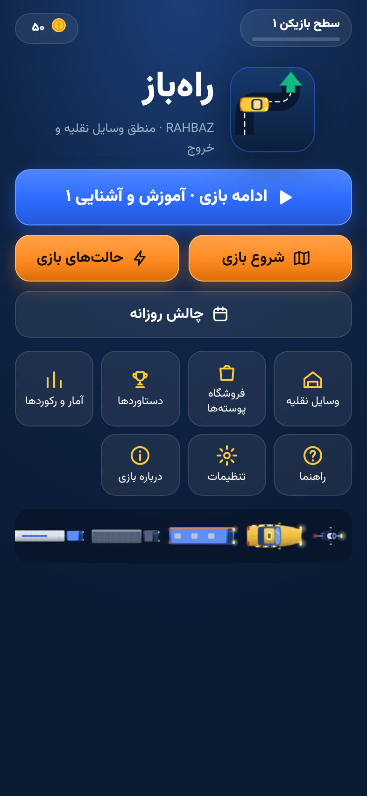
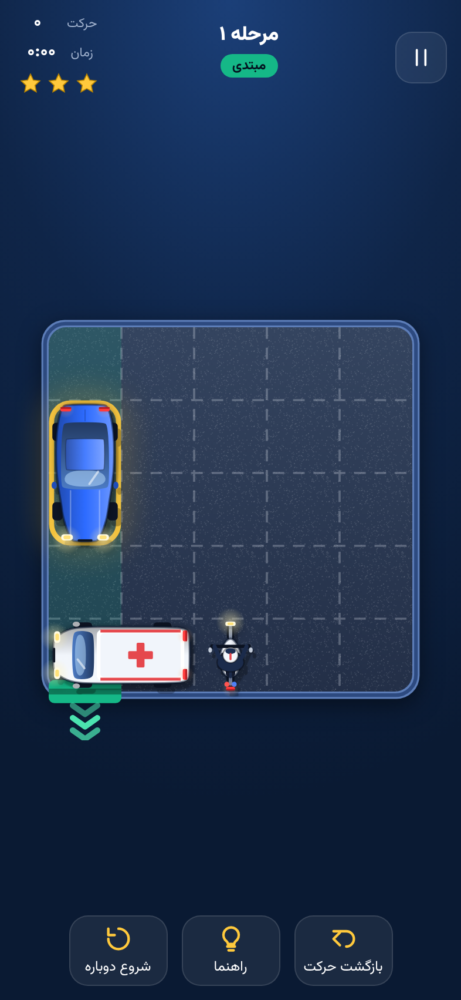
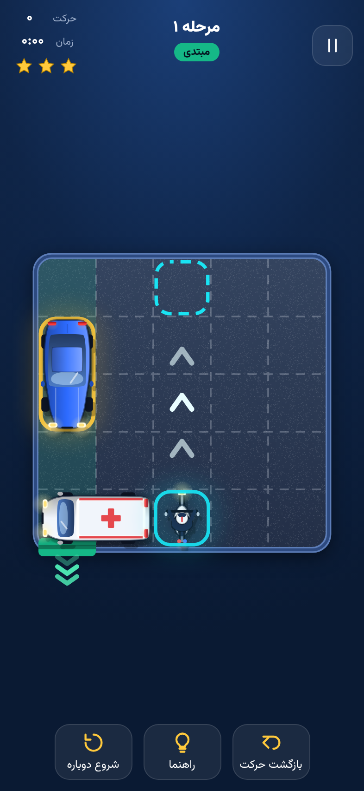
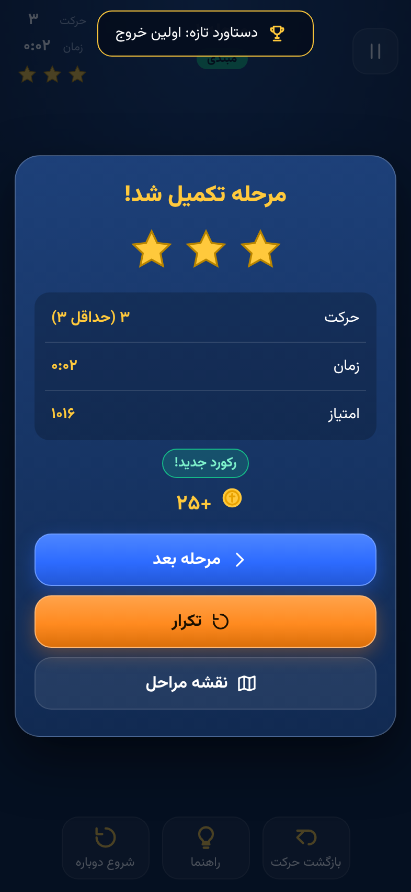

# راه‌باز – RAHBAZ (Vehicle Logic & Escape)
نسخه ۱٫۰٫۰ · سازنده و توسعه‌دهنده: **حمید یارعلی (Hamid Yarali)**

«راه‌باز» یک بازی معمایی مستقل و **کاملاً آفلاین** برای اندروید است. هر وسیله نقلیه – از موتورسیکلت یک‌خانه‌ای تا اتوبوس، کامیون، تریلی شش‌خانه‌ای و بیل مکانیکی ۲×۲ – فقط در راستای خودش می‌لغزد. مسیر را باز کنید تا وسیلهٔ طلایی‌درخشان از دروازهٔ سبز خارج شود.

| صفحه اصلی | بازی | راهنما (Hint) | پایان مرحله |
|---|---|---|---|
|  |  |  |  |

> تصاویر از خود بازی در مرورگر Chromium با اندازهٔ صفحهٔ گوشی گرفته شده‌اند؛ شبیه‌سازی‌اند و عکس از گوشی واقعی نیستند.

## امکانات
- **۱۱۰ مرحلهٔ آماده** در ۱۱ بسته: آموزش و آشنایی، پارکینگ شهری، خیابان شلوغ، ترمینال اتوبوس، پارکینگ کامیون‌ها، منطقه حمل‌ونقل سنگین، منطقه صنعتی، منطقه عمرانی، مسیر امدادی، مراحل حرفه‌ای و فرار موتورسیکلت‌ها. جدول‌ها از ۵×۵ تا ۸×۸ (تولیدکننده تا ۹×۹ را پشتیبانی می‌کند). **حل‌پذیری همهٔ مراحل با الگوریتم BFS اثبات شده** و حداقل حرکت دقیق هر مرحله ذخیره است.
- **۷۵ نوع وسیله نقلیه** در ۸ دسته (موتورسیکلت ۸، سواری ۱۶، ون و مینی‌بوس ۷، اتوبوس ۷، کامیون ۱۱، تریلی و کشنده ۹، ماشین‌آلات ۱۲، وسایل خدماتی ۵). هر کدام اندازه، سرعت، امتیاز و طراحی Top-Down اختصاصی دارد (فقط تفاوت رنگ نیست).
- **۱۰ حالت بازی**: کلاسیک، فرار موتورسیکلت‌ها، حمل‌ونقل سنگین، حمل‌ونقل عمومی، مأموریت امداد، منطقه عمرانی، بی‌پایان، چالش روزانه (با تاریخ دستگاه)، مسابقه با زمان، حداقل حرکت.
- **راهنمای هوشمند**: حرکت پیشنهادی همیشه مجاز و بهینه است؛ «نمایش راه‌حل» کل راه‌حل را اجرا می‌کند. بازگشت حرکت، شروع دوباره، توقف و محدودیت حرکت در برخی مراحل.
- **پیشرفت**: ۱ تا ۳ ستاره، امتیاز، سکه، XP و سطح بازیکن، ۱۰ دستاورد، آمار و رکوردها.
- **فروشگاه**: ۸ پوسته (کلاسیک، اسپرت، پلیس، امداد، سنگین، عمرانی، نئونی، رترو) با سکه‌های درون‌بازی و «گاراژ» برای دیدن همهٔ وسایل.
- **فارسی (راست‌به‌چپ، پیش‌فرض) و انگلیسی (چپ‌به‌راست)**؛ جلوه‌های صوتی و موسیقی با WebAudio ساخته می‌شوند (بدون فایل صوتی).
- **حریم خصوصی**: بدون مجوز، بدون اینترنت، بدون تبلیغ و بدون ردیابی. اطلاعات فقط روی دستگاه ذخیره می‌شود (نسخه‌دار و مقاوم در برابر خرابی).
- **کم‌حجم**: APK ریلیز امضاشده حدود **۰٫۲۹ مگابایت** است.

## نحوهٔ ساخت
بازی با **HTML/CSS/JavaScript** نوشته شده، با esbuild باندل می‌شود (هدف: Chrome/WebView 61 به بالا) و داخل یک پوستهٔ ساده **WebView** اندروید بسته‌بندی می‌شود. محتوا از `assets/www` و آدرس مجازی `https://appassets.androidplatform.net/` سرو می‌شود، پس هیچ دسترسی به شبکه وجود ندارد.

ساختار اصلی: `src/js` (موتور، Solver، تولیدکنندهٔ مرحله، رندر، رابط)، `src/boot.js` (بوت‌لودر ES5 با polyfill و صفحهٔ خطا)، `android/` (پوسته، منابع، پروژهٔ Gradle، قالب APK)، `scripts/` (اسکریپت‌های ساخت)، `tests/` (تست‌ها)، `docs/` (مستندات).

## ساخت APK (بدون Android SDK)
نیازمندی‌ها: **Node 18+** و **JDK 11+** (دستورهای `java` و `keytool`).
```sh
npm ci
sh scripts/build_android.sh        # ویندوز: scripts\build_android.bat
# خروجی: release/RAHBAZ-v1.0.2.apk (+ .sha256 و CERTIFICATE.txt)
```
این اسکریپت تست‌ها را اجرا می‌کند، در اولین اجرا **کلید ریلیز اختصاصی** می‌سازد (پوشهٔ `Keystore/` و فایل `keystore.properties`؛ هر دو در `.gitignore` هستند)، بسته را می‌سازد، با zipalign و امضای v1/v2/v3 امضا می‌کند و بررسی می‌کند گواهی **کلید دیباگ اندروید نباشد**. ابزار `uber-apk-signer` از GitHub Releases دانلود و با SHA-256 قفل شده است.

> **پوشهٔ `Keystore/` را نگه دارید.** همهٔ آپدیت‌های بعدی باید با همین کلید امضا شوند؛ گم‌شدنش یعنی دیگر نمی‌شود آپدیت داد. هرگز آن را در گیت‌هاب نگذارید.
> کلیدی که اسکریپت می‌سازد روی همان دستگاهی ساخته می‌شود که اسکریپت را اجرا می‌کند. اگر می‌خواهید کلید فقط روی کامپیوتر خودتان باشد، قبل از اولین انتشار `node scripts/make-keystore.mjs` را روی کامپیوتر خودتان اجرا کنید.

### AAB / Gradle / GitHub Actions
پوشهٔ `android/` یک پروژهٔ استاندارد Gradle است (AGP 8.7.3، Gradle 8.9، SDK ۳۴، حداقل ۲۴). بعد از ساخت کلید: `cd android && gradle bundleRelease` (فایل `gradlew` همراه نیست؛ در صورت نیاز یک‌بار `gradle wrapper` بزنید). Workflow گیت‌هاب (`.github/workflows/android-release.yml`) با تگ `v*` اجرا می‌شود و به این Secretها نیاز دارد: `ANDROID_KEYSTORE_BASE64`، `ANDROID_KEYSTORE_PASSWORD`، `ANDROID_KEY_ALIAS`، `ANDROID_KEY_PASSWORD`. **پروژهٔ Gradle و workflow نوشته شده‌اند ولی در محیط ساخت اجرا نشدند**؛ آن‌ها را آزمایش‌نشده فرض کنید.

## وضعیت تست (صادقانه)
- ✔ ۱۲ تست واحد موفق: موتور، Solver، حل‌مجدد و بازپخش حرکت‌به‌حرکت هر ۱۱۰ مرحله، قطعیت تولیدکننده و چالش روزانه، مجاز بودن راهنما.
- ✔ تست‌های سرتاسری در Chromium (UA گوشی، لمس، اندازه‌های ۳۹۳×۸۵۱، ۸۵۱×۳۹۳، ۶۴۰×۳۶۰ و ۸۲۰×۱۱۸۰): حل یک مرحله با کشیدن واقعی، ذخیره و بارگذاری دوباره، دکمهٔ Back، توقف در پس‌زمینه، فارسی/انگلیسی، حالت‌های بی‌پایان/روزانه/زمانی، نبودن درخواست خارجی و خطای CSP، اجرا با حذف APIهای جدید، صفحهٔ خطای تشخیصی.
- ✔ APK: امضای v1/v2/v3 تأیید شد، گواهی RSA 4096 ریلیز، بدون permission، debuggable=false.
- ✘ **روی گوشی یا شبیه‌ساز واقعی اندروید اجرا نشده است.** لطفاً روی گوشی واقعی نصب کنید و اگر مشکلی بود اسکرین‌شات صفحهٔ وضعیت (که هنگام شکست راه‌اندازی نمایش داده می‌شود) را بفرستید.
- ✘ AAB و مسیر Gradle در این محیط ساخته نشدند.

## محدودیت‌ها و تفاوت با شرح اولیه
- در شرح پروژه هم Kotlin/Compose آمده بود و هم قالب ساخت با پوستهٔ WebView. من **پوستهٔ WebView** را پیاده‌سازی کردم (آفلاین ساخته می‌شود، بسیار کم‌حجم است)؛ برنامه Kotlin نیست.
- تبلیغات، خرید درون‌برنامه‌ای و بقیهٔ مدل‌های درآمدزایی **پیاده‌سازی نشده‌اند** (بازی بدون مجوز و بدون شبکه است). پوسته‌ها فقط با سکهٔ درون‌بازی خریده می‌شوند.
- پوسته‌ها رنگ‌بندی و تزئین همان طراحی‌ها را عوض می‌کنند، نه مجموعهٔ طراحی جداگانه. لرزش (vibration) استفاده نشده چون به مجوز نیاز دارد.
- تریلی‌ها واحد حرکتی یکپارچه‌اند؛ وسیلهٔ اصلی (طلایی) همیشه یک‌خانه عرض دارد و ماشین‌آلات ۲×۲ نقش مانع متحرک را دارند.

## مجوز
MIT © ۲۰۲۶ Hamid Yarali (فایل LICENSE). فونت وزیرمتن با مجوز SIL OFL 1.1.
